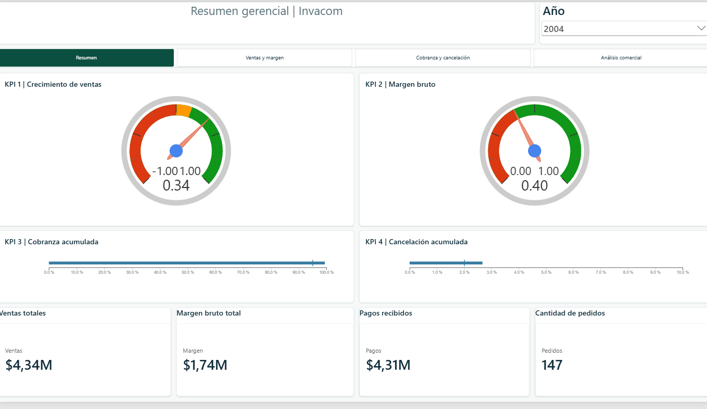
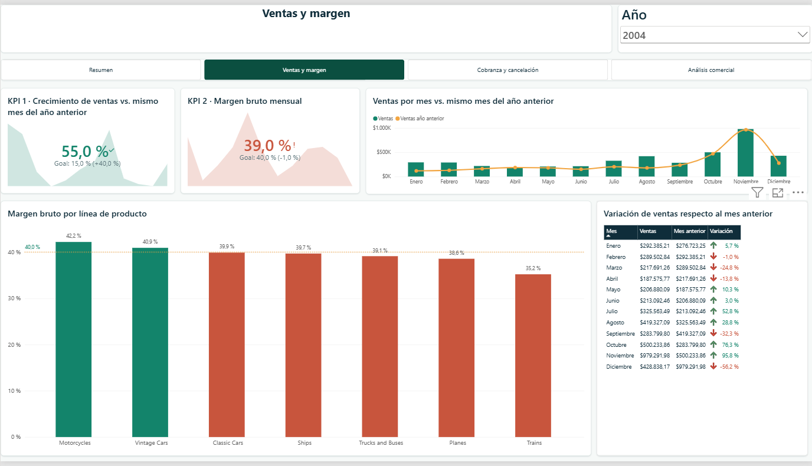
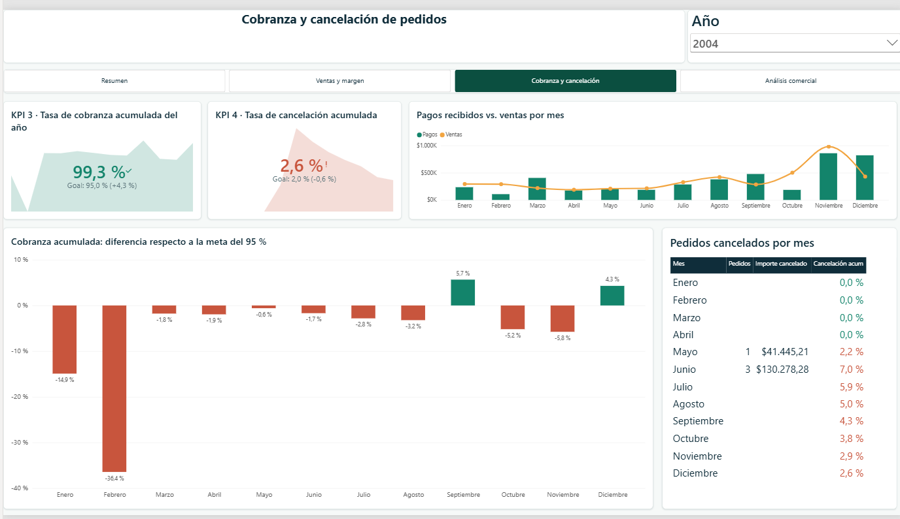
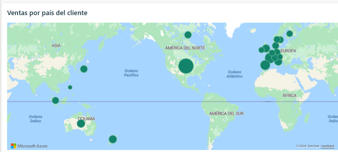

# Proyecto 2: Dashboard gerencial de Invacom

Universidad Técnica Nacional, Sede Regional de San Carlos
Minería de Datos, III cuatrimestre 2026
Profesor: Freddy Gerardo Rocha Boza
Versión documentada: 26 de noviembre de 2026
Archivo de análisis: `Proyecto2/Dashboard_Invacom.pbix`

| Integrante | Responsabilidad principal |
| --- | --- |
| Edgar Eliam Araya Alvarado | KPI de ventas y margen; preparación del modelo |
| José Pablo Soto Quesada | KPI de cobranza y cancelación; visualizaciones y navegación |

## Contenido

1. [Resumen ejecutivo](#1-resumen-ejecutivo)
2. [Base de datos y modelo](#2-base-de-datos-y-modelo)
3. [Metodología para definir los KPI](#3-metodología-para-definir-los-kpi)
4. [Medidas DAX](#4-medidas-dax)
5. [Resultados de 2004](#5-resultados-de-2004)
6. [Páginas del dashboard](#6-páginas-del-dashboard)
7. [Capturas](#7-capturas)
8. [Verificación de requisitos](#8-verificación-de-requisitos)
9. [Consideraciones y limitaciones](#9-consideraciones-y-limitaciones)
10. [Conclusión](#10-conclusión)
11. [Referencias](#referencias)

En este documento se describen la metodología usada para definir los KPI, el desglose S.M.A.R.T. de cada uno, el modelo de datos, las medidas DAX, los resultados de 2004 y las páginas del tablero de Power BI.

## 1. Resumen ejecutivo

En el proyecto 2 se construyó un tablero de control en Power BI sobre el Data Warehouse de Invacom del proyecto 1. El tablero muestra cuatro KPI aprobados por el profesor, dos por cada integrante, sobre ventas, margen bruto, cobranza y cancelación de pedidos. Cada KPI tiene su meta, una comparación por mes y gráficos de contexto por país, territorio, vendedor y línea de producto.

El tablero tiene cuatro páginas: Resumen, Ventas y margen, Cobranza y cancelación y Análisis comercial. Se usaron dos visuales de AppSource (Dial Gauge y Bullet Chart), el mapa de Azure Maps, el árbol de descomposición, medidas DAX con inteligencia de tiempo y formato condicional.

## 2. Base de datos y modelo

Se reutilizó el Data Warehouse del proyecto 1, que está en Oracle con el esquema INVACOM_DW, y se conectó desde Power BI. El modelo es una constelación de hechos con cuatro dimensiones y dos tablas de hechos. Las ventas y los pagos están en tablas separadas, por lo que no se unen fila por fila.

| Tabla | Uso en el tablero |
| --- | --- |
| DIM_CLIENTE | Clientes y país para el contexto geográfico |
| DIM_PRODUCTO | Líneas de producto |
| DIM_FECHA | Fechas, periodos y selector de año |
| DIM_VENDEDOR | Vendedores y territorios |
| FACT_VENTAS | Líneas de pedido, ventas, margen y estado del pedido |
| FACT_PAGOS | Pagos recibidos y fechas de pago |

Las medidas Ventas, Margen y Pedidos no incluyen los pedidos con estado «Cancelled». El KPI 4 sí los incluye, ya que mide qué parte de lo pedido se canceló. Los pagos y las ventas son hechos distintos, por lo que la cobranza compara los totales de cada periodo y no cada factura con su pago.

## 3. Metodología para definir los KPI

Para definir los KPI se revisaron tres referencias. Kaplan y Norton (1992) proponen el Balanced Scorecard, que mide el desempeño de una empresa desde cuatro perspectivas: financiera, del cliente, de procesos internos y de aprendizaje y crecimiento. Con los datos del Data Warehouse de Invacom solo se pueden medir las perspectivas financiera y del cliente, por lo que los cuatro KPI son de esas dos.

Parmenter (2020) recomienda que cada indicador tenga un responsable que responda por su resultado y que se mida con frecuencia. Por eso cada integrante quedó a cargo de dos KPI y todos se revisan por mes.

Doran (1981) propuso escribir los objetivos con los criterios S.M.A.R.T. En el curso estos criterios se usan como específico, medible, alcanzable, relevante y temporal, y cada KPI se desglosó con ellos en la sección 3.1.

Primero se eligieron las perspectivas del Balanced Scorecard que cubren los datos. Después se revisó qué tablas del Data Warehouse permiten calcular cada indicador. Las metas se fijaron con los valores reales de 2003, 2004 y 2005, para que se puedan cumplir sin que se cumplan siempre. Al final se envió la propuesta al profesor, que aprobó los cuatro KPI.

| KPI | Responsable | Cálculo | Meta |
| --- | --- | --- | --- |
| 1. Crecimiento de ventas | Edgar Eliam Araya Alvarado | (Ventas del mes − ventas del mismo mes del año anterior) / ventas del mismo mes del año anterior | ≥ 15 % |
| 2. Margen bruto | Edgar Eliam Araya Alvarado | Margen bruto / ventas | ≥ 40 % |
| 3. Cobranza acumulada | José Pablo Soto Quesada | Pagos recibidos desde enero / ventas desde enero | ≥ 95 % |
| 4. Cancelación acumulada | José Pablo Soto Quesada | Importe cancelado desde enero / importe de todos los pedidos desde enero | ≤ 2 % |

### 3.1 Desglose S.M.A.R.T. de cada KPI

#### KPI 1. Crecimiento de ventas

| Elemento | Descripción |
| --- | --- |
| Responsable | Edgar Eliam Araya Alvarado |
| Fórmula | (Ventas del mes − ventas del mismo mes del año anterior) / ventas del mismo mes del año anterior |
| Específico | Mide cuánto crecen las ventas de cada mes contra el mismo mes del año anterior |
| Medible | Se calcula con FACT_VENTAS y DIM_FECHA |
| Alcanzable | En 2004 las ventas crecieron 33,7 %, y la meta de 15 % se cumplió en 12 de los 17 meses que se pueden comparar |
| Relevante | Le sirve a la presidencia y a la vicepresidencia de ventas para saber si el negocio crece |
| Temporal | Se mide cada mes, de enero de 2004 a mayo de 2005 |

#### KPI 2. Margen bruto

| Elemento | Descripción |
| --- | --- |
| Responsable | Edgar Eliam Araya Alvarado |
| Fórmula | (Ventas − costo de compra) / ventas |
| Específico | Mide qué parte de lo vendido queda después de pagar el costo del producto |
| Medible | Se calcula con las columnas MARGEN e IMPORTE_TOTAL de FACT_VENTAS |
| Alcanzable | El margen fue de 39,9 % en 2003 y 40,0 % en 2004, y la meta de 40 % se cumplió en 7 de los 12 meses de 2004 |
| Relevante | Le sirve a la presidencia y a la vicepresidencia de ventas para revisar la ganancia de cada línea de producto |
| Temporal | Se mide cada mes, de enero de 2003 a mayo de 2005 |

#### KPI 3. Tasa de cobranza acumulada

| Elemento | Descripción |
| --- | --- |
| Responsable | José Pablo Soto Quesada |
| Fórmula | Pagos recibidos desde enero / ventas desde enero |
| Específico | Mide qué parte de lo vendido en el año ya pagaron los clientes |
| Medible | Se calcula con FACT_PAGOS, FACT_VENTAS y DIM_FECHA |
| Alcanzable | La cobranza fue de 100,0 % en 2003 y 99,3 % en 2004 |
| Relevante | Le sirve a los gerentes regionales y a los representantes de ventas para dar seguimiento a los pagos de sus clientes |
| Temporal | Se mide cada mes, sumando desde enero, y se evalúa al cierre de cada año |

#### KPI 4. Tasa de cancelación acumulada

| Elemento | Descripción |
| --- | --- |
| Responsable | José Pablo Soto Quesada |
| Fórmula | Importe de pedidos cancelados desde enero / importe de todos los pedidos desde enero |
| Específico | Mide qué parte de lo que piden los clientes se pierde por pedidos cancelados |
| Medible | Se calcula con las columnas IMPORTE_TOTAL y ESTADO_PEDIDO de FACT_VENTAS |
| Alcanzable | La cancelación fue de 2,0 % en 2003 y 3,8 % en 2004, por lo que la meta ya se cumplió una vez |
| Relevante | Le sirve a la vicepresidencia de ventas y a los gerentes regionales para detectar pérdidas de ventas |
| Temporal | Se mide cada mes, sumando desde enero, y se evalúa al cierre de cada año |

## 4. Medidas DAX

Se crearon medidas base, medidas de periodos anteriores y medidas acumuladas del año. En las medidas se usan 16 funciones DAX: CALCULATE, SUM, SAMEPERIODLASTYEAR, DIVIDE, PREVIOUSMONTH, DISTINCTCOUNT, DATEADD, IF, ISBLANK, BLANK, MAX, ALL, MIN, TOTALYTD, FILTER y COALESCE. VAR y RETURN no se cuentan como funciones.

### 4.1 Medidas del modelo

| Medida | Definición |
| --- | --- |
| Ventas | Suma de IMPORTE_TOTAL sin pedidos cancelados, con CALCULATE y SUM |
| Ventas año anterior | Ventas del mismo periodo del año anterior, con SAMEPERIODLASTYEAR |
| Crecimiento ventas % | KPI 1. (Ventas − ventas año anterior) / ventas año anterior, con DIVIDE |
| Ventas mes anterior | Ventas del mes anterior, con PREVIOUSMONTH |
| Variación mensual % | Cambio de las ventas contra el mes anterior |
| Ventas trimestre anterior | Ventas del trimestre anterior, con DATEADD |
| Margen | Suma de MARGEN sin pedidos cancelados |
| Margen % | KPI 2. Margen / ventas |
| Pedidos | Pedidos distintos sin cancelados, con DISTINCTCOUNT |
| Pedidos totales | Pedidos distintos de todos los estados |
| Valor promedio por pedido | Ventas / pedidos |
| Pagos | Suma de FACT_PAGOS[MONTO] |
| Cobranza acumulada % | KPI 3. Pagos desde enero / ventas desde enero, con TOTALYTD |
| Ventas canceladas | Importe de los pedidos con estado Cancelled, con FILTER |
| Pedidos cancelados | Pedidos distintos con estado Cancelled |
| Cancelación acumulada % | KPI 4. Importe cancelado desde enero / importe de todos los pedidos desde enero |
| Meta crecimiento, Meta margen, Meta cobranza y Meta cancelación | Valores fijos de 15 %, 40 %, 95 % y 2 % |
| Diferencia crecimiento, Diferencia margen, Diferencia cobranza y Diferencia cancelación | Distancia de cada KPI a su meta. Se usan en el formato condicional, con IF, ISBLANK y BLANK |
| Gauge Crecimiento y Gauge Margen | KPI 1 y KPI 2 multiplicados por 100, ya que el Dial Gauge muestra el valor sin formato de porcentaje |
| Gauge Min, Gauge Max, Gauge Max 100, Gauge Min Margen, Gauge Max Cancelacion, Gauge Meta Inicio, Gauge Meta Crecimiento y Gauge Meta Margen | Límites y zonas de los medidores y de los gráficos de viñeta del Resumen |

### 4.2 KPI 1 y KPI 2: crecimiento y margen

El KPI 1 usa SAMEPERIODLASTYEAR para traer las ventas del mismo periodo del año anterior y DIVIDE para que el resultado quede vacío cuando no hay ventas del año anterior, como en 2003. El KPI 2 divide la medida Margen entre Ventas. En la página Ventas y margen los dos KPI se muestran por mes, y en el Resumen se muestran con el año completo.

```dax
Ventas año anterior = CALCULATE([Ventas], SAMEPERIODLASTYEAR(DIM_FECHA[FECHA]))
Crecimiento ventas % = DIVIDE([Ventas] - [Ventas año anterior], [Ventas año anterior])
Margen % = DIVIDE([Margen], [Ventas])
```

### 4.3 KPI 3: cobranza acumulada

La tasa se calcula con TOTALYTD de los pagos entre TOTALYTD de las ventas. La medida deja de mostrar valores después del último pago registrado, para que no se repita el acumulado en meses sin datos. El resultado compara totales del año, por lo que no indica qué facturas siguen pendientes.

```dax
Cobranza acumulada % =
VAR UltimoPago = CALCULATE(MAX(FACT_PAGOS[FECHA_KEY]), ALL(FACT_PAGOS))
RETURN IF(MIN(DIM_FECHA[FECHA_KEY]) > UltimoPago, BLANK(),
    DIVIDE(TOTALYTD([Pagos], DIM_FECHA[FECHA]), TOTALYTD([Ventas], DIM_FECHA[FECHA])))
```

### 4.4 KPI 4: cancelación acumulada

Se suma el IMPORTE_TOTAL de los pedidos con estado «Cancelled» desde enero y se divide entre el importe de todos los pedidos desde enero, con TOTALYTD. COALESCE cambia el numerador vacío por cero, por lo que los meses sin cancelaciones muestran 0 %. La medida deja de mostrar valores después de la última venta registrada.

```dax
Cancelación acumulada % =
VAR UltimaVenta = CALCULATE(MAX(FACT_VENTAS[FECHA_KEY]), ALL(FACT_VENTAS))
VAR Cancelado = TOTALYTD(CALCULATE(SUM(FACT_VENTAS[IMPORTE_TOTAL]),
    FILTER(FACT_VENTAS, FACT_VENTAS[ESTADO_PEDIDO] = "Cancelled")), DIM_FECHA[FECHA])
VAR Total = TOTALYTD(SUM(FACT_VENTAS[IMPORTE_TOTAL]), DIM_FECHA[FECHA])
RETURN IF(MIN(DIM_FECHA[FECHA_KEY]) > UltimaVenta, BLANK(), DIVIDE(COALESCE(Cancelado, 0), Total))
```

### 4.5 Metas e interpretación

En 2004 las ventas crecieron 33,7 % contra 2003, y la meta de 15 % se cumplió en 9 de los 12 meses. En diciembre de 2004, que es el mes que muestra el visual KPI de la página Ventas y margen, el crecimiento fue de 55,0 %. El margen bruto de 2004 fue de 40,04 %, por lo que cumple la meta de 40 %, y se cumplió en 7 de los 12 meses. La cobranza acumulada de 2004 llegó a 99,3 %, mayor que la meta de 95 %. La cancelación acumulada de 2004 fue de 3,8 %, mayor que el máximo de 2 %. El valor más alto se dio en junio, con 10,9 % acumulado desde enero.

## 5. Resultados de 2004

Los valores siguientes son los que muestra el tablero con el año 2004 seleccionado.

| Indicador o total | Valor | Interpretación |
| --- | --- | --- |
| Crecimiento de ventas | 33,7 % en el año; 55,0 % en diciembre | Cumple la meta de 15 % |
| Margen bruto | 40,0 % (40,04 %) | Cumple la meta de 40 % |
| Cobranza acumulada | 99,3 % | Cumple la meta de 95 % |
| Cancelación acumulada | 3,8 % | No cumple el máximo de 2 % |
| Ventas totales | $4.344.182,02 | Sin pedidos cancelados |
| Margen bruto total | $1.739.574,51 | Sin pedidos cancelados |
| Pagos recibidos | $4.313.328,25 | Pagos registrados en FACT_PAGOS |
| Cantidad de pedidos | 147 | Sin pedidos cancelados |

## 6. Páginas del dashboard

| Página | Visualizaciones |
| --- | --- |
| Resumen | Dos medidores Dial Gauge para los KPI 1 y 2, dos gráficos Bullet Chart para los KPI 3 y 4 y una tarjeta con los totales del año |
| Ventas y margen | KPI 1 y 2, ventas por mes contra el mismo mes del año anterior, margen por línea de producto y tabla de variación mensual |
| Cobranza y cancelación | KPI 3 y 4, pagos contra ventas por mes, diferencia de cobranza con la meta y pedidos cancelados por mes |
| Análisis comercial | Azure Maps por país, árbol de descomposición por territorio, vendedor y línea de producto, ventas por territorio y Top 5 de vendedores |

Todas las páginas tienen un navegador entre páginas y un selector de año sincronizado. El formato condicional pinta de verde los valores que cumplen la meta y de rojo los que no la cumplen. Los dos visuales de AppSource son Dial Gauge, de CloudFronts Technologies, y Bullet Chart, de Microsoft.

## 7. Capturas

Las capturas siguientes se tomaron en Power BI Desktop con el año 2004 seleccionado.

### 7.1 Resumen



La página muestra los cuatro KPI y los totales del año. En el KPI 4 la barra pasa la marca de la meta de 2 %.

### 7.2 Ventas y margen



### 7.3 Cobranza y cancelación



La tabla muestra por mes los pedidos cancelados, el importe cancelado y la tasa acumulada. De enero a abril de 2004 no hubo cancelaciones, por lo que la tasa es 0 % en esos meses.

### 7.4 Análisis comercial



La página tiene un mapa de ventas por país del cliente, un árbol de descomposición por territorio, vendedor y línea de producto, un gráfico de ventas por territorio y el Top 5 de vendedores. En 2004 el vendedor con más ventas fue Gerard Hernandez, con $487.510,31.

## 8. Verificación de requisitos

| Requisito del enunciado | Evidencia | Estado |
| --- | --- | --- |
| Power BI conectado al DW | Modelo dimensional y archivo .pbix | Implementado |
| Metodología para definir KPI | Sección 3 | Implementado |
| KPI con atributos S.M.A.R.T., responsables y metas | Sección 3.1, dos KPI por integrante | Implementado |
| Número apropiado de gráficos | Entre 4 y 5 gráficos por página, sin contar filtros ni títulos | Implementado |
| Interfaz personalizada | Tema Invacom, títulos, colores, etiquetas y navegación | Implementado |
| Gráficos de contexto | Mapa, árbol, territorio y Top 5 de vendedores | Implementado |
| Comparaciones mensuales | Gráficos y tablas mes a mes | Implementado |
| Cálculos DAX distintos | 16 funciones DAX en las medidas | Implementado |
| Dos visuales no nativos | Dial Gauge y Bullet Chart | Implementado |
| Mapa y árbol de descomposición | Azure Maps y árbol de descomposición | Implementado |
| Formato condicional | Verde y rojo según la meta en barras, tablas y KPI | Implementado |

## 9. Consideraciones y limitaciones

- Los valores de las tarjetas y de los KPI dependen del año elegido en el selector, por lo que cambian al cambiar de año.
- Las ventas no incluyen los pedidos cancelados, pero el KPI de cancelación sí los usa en el numerador y en el denominador.
- El KPI de cobranza compara los pagos y las ventas acumulados del año. No mide la deuda de cada cliente.
- Para revisar los valores con otros filtros se debe abrir el archivo `Dashboard_Invacom.pbix`.

## 10. Conclusión

Se concluye que el tablero permite revisar en un solo archivo los cuatro KPI de Invacom. En 2004 se cumplieron las metas de crecimiento de ventas (33,7 %), margen bruto (40,0 %) y cobranza (99,3 %), y no se cumplió la de cancelación, que llegó a 3,8 %. Los gráficos por país, territorio y vendedor ayudan a buscar el origen de cada resultado.

Se recomienda revisar los pedidos cancelados de 2004 por cliente y por vendedor, ya que esa tasa casi duplicó la meta.

## Referencias

Araya Alvarado, E. E., y Soto Quesada, J. P. (2026). *Proyecto 1: Data Warehouse de Invacom Inc. S. A.* [Repositorio y documentación académica]. https://github.com/jpablosq/Proyecto-Invacom

Doran, G. T. (1981). There's a S.M.A.R.T. way to write management's goals and objectives. *Management Review, 70*(11), 35-36.

Kaplan, R. S., y Norton, D. P. (1992). The balanced scorecard: Measures that drive performance. *Harvard Business Review, 70*(1), 71-79.

Microsoft. (s. f.). *Funciones de inteligencia de tiempo*. Microsoft Learn. https://learn.microsoft.com/dax/time-intelligence-functions-dax

Parmenter, D. (2020). *Key performance indicators: Developing, implementing, and using winning KPIs* (4.ª ed.). Wiley.

Universidad Técnica Nacional. (2026). *Proyecto #2: Visualización y KPIs gerenciales en Power BI para Grupo Innova S. A.* [Enunciado del curso].
